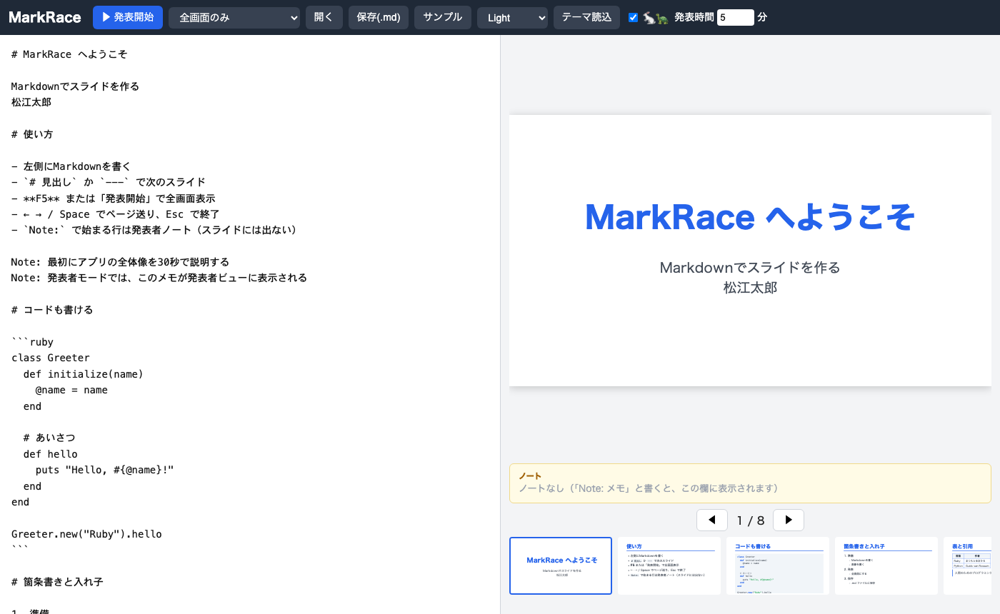

# MarkRace

**Markdown で書いて、ブラウザでそのままプレゼン。** インストール不要のスライドアプリです。

[English](#english) | 日本語



## 特長

- **インストール不要**: HTML / CSS / JavaScript だけ。外部ライブラリもビルドもありません。`index.html` を開けば動きます。
- **左に書いて右で確認**: 編集とプレビューが並び、下にサムネイルが出ます。内容はブラウザに自動保存されます。
- **発表者モード**: 現在のスライド・次のスライド・発表者ノート・経過時間を表示します。
- **画像と動画**: ローカルの画像・動画（mp4 / webm / ogg / mov）と YouTube を埋め込めます。
- **うさぎとかめ**: スライドの進み具合（うさぎ）と経過時間（かめ）を競争させて、ペース配分の目安にできます。
- **テーマ**: CSS ファイル1つで見た目を変えられます。
- **データは手元に**: 作ったスライドは普通の `.md` ファイル。サーバに送信されることはありません。
- **Rabbit 互換の記法**に一部対応しています。

## はじめかた

1. このリポジトリをダウンロードして、`index.html` をブラウザで開きます。
2. 左の欄に Markdown を書きます。
3. 「▶ 発表開始」（または `F5`）でプレゼンを始めます。

Web サーバに置く場合は、フォルダごとアップロードするだけです。
GitHub Pages で公開するなら、リポジトリの Settings → Pages で公開するブランチを選びます。

## 書き方

```markdown
# タイトル

最初のスライドです。

Note: 発表者だけに見えるメモ

---

# 画像と動画


```

- `# 見出し` または `---` でスライドが切り替わります。
- `Note:`（または `ノート:`）で始まる行は発表者ノートです。スライドには出ません。
- 画像と動画は `` で書きます。YouTube は URL を指定します。
- Rabbit 互換: `## note` から次の見出しまでは発表者用として非表示になります。`キー` の次の行に `: 値` と書くメタ情報は、値だけが表示されます（`allotted_time` `start_time` `end_time` `theme` は表示されません）。

「開く」「保存(.md)」のほか、`.md` ファイルのドラッグ＆ドロップにも対応しています。

## 発表モード

発表開始ボタンの横の選択欄で選びます。

| 選択肢 | 内容 |
|---|---|
| 全画面のみ | スライドだけを全画面で表示 |
| 全画面＋発表者モード | 現在のスライド（大）・次のスライド（小）・ノート・経過時間を表示 |

発表者モードの表示方法は、ブラウザによって異なります。

- Chrome / Edge: 別ウィンドウ（Document Picture-in-Picture、常に最前面）。別窓を開くと全画面が解除されるため、画面をクリックして全画面に戻します。
- それ以外: 全画面の上に重ねるパネル（ドラッグで移動、サイズ変更可）。

### キー操作

| キー | 動作 |
|---|---|
| `→` `↓` `PageDown` `Space` `Enter` `n` | 次へ |
| `←` `↑` `PageUp` `Backspace` `p` | 前へ |
| `Home` / `End` | 最初 / 最後 |
| `f` | 全画面の切り替え |
| `v` | 発表者パネルの表示・非表示（重ね表示のとき） |
| `Esc` / `F5` | 発表を終了 |

### うさぎとかめ

ツールバーでオン／オフと発表時間（分）を設定します。かめは発表時間でゴールします。うさぎがかめより先にいれば、予定より早いペースです。

## テーマ

`themes/*.css` に `.theme-ID` を定義し、`--bg` `--fg` `--accent` `--code-bg` を指定します。
[themes/themes.js](themes/themes.js) に1行足すと、選択欄に出ます。

「テーマ読込」ボタンで `.css` を読み込むと、そのブラウザに保存されます。

## フォルダ構成

```
index.html / style.css / app.js
images/   サンプル画像（うさぎ・かめを含む）
videos/   サンプル動画
themes/   themes.js, light.css, dark.css, rabbit.css
```

## 動作環境

- Chrome / Edge: 動作確認済み。発表者モードは別ウィンドウで表示されます。
- Firefox / Safari: 未確認です。発表者モードは重ね表示のパネルになります。不具合があれば Issue でお知らせください。

## ライセンス

[MIT License](LICENSE)

---

## English

**MarkRace** turns Markdown into a slideshow right in your browser. No install, no build, no external libraries: just HTML, CSS and JavaScript. Open `index.html` and start writing.

**Features**

- Live editor and preview with thumbnails; auto-saved in your browser
- Presenter mode with current slide, next slide, speaker notes and an elapsed-time clock (Document Picture-in-Picture in Chrome / Edge, an overlay panel elsewhere)
- Images and videos (mp4 / webm / ogg / mov) and YouTube embeds
- A rabbit (slide progress) and a tortoise (elapsed time) to help you pace your talk
- Themes are plain CSS files
- Everything stays on your machine; slides are ordinary `.md` files

**Syntax**

- A `# heading` or `---` starts a new slide.
- Lines starting with `Note:` (or `ノート:`) are speaker notes.
- `` embeds an image or video.

**Keys**: `→` / `Space` next, `←` previous, `Home` / `End`, `f` fullscreen, `Esc` or `F5` to quit.

**Browsers**: tested on Chrome. Safari and Firefox are untested. The user interface is currently in Japanese.

Released under the [MIT License](LICENSE).
